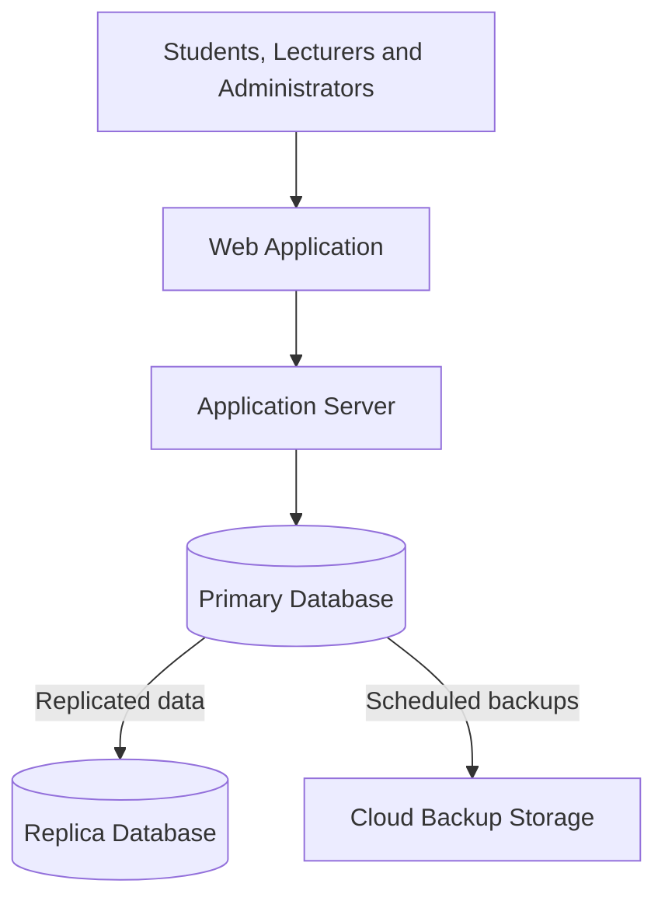

# Portfolio 5: Distributed and Cloud Architecture Diagram

The diagram below illustrates the proposed architecture for the University Student Result Portal.

## Diagram Explanation

1. Users access the portal through the web application.
2. The application server processes requests and applies access controls.
3. The primary database stores official academic records.
4. The replica database receives replicated data to support selected availability and read requirements.
5. Cloud backup storage holds backups for recovery.

**Note:** This is a proposed design. The diagram does not represent a deployed or tested cloud environment.
